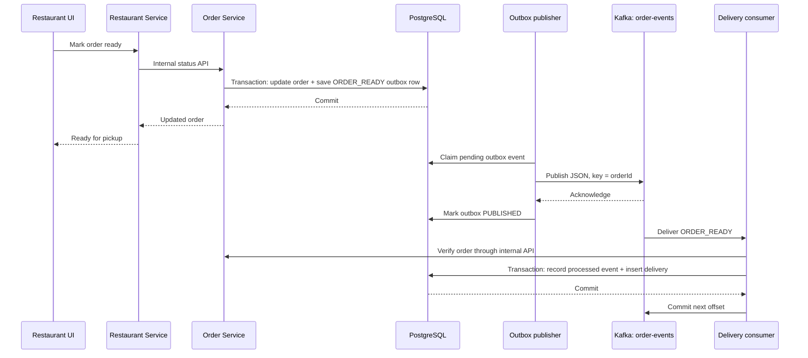

# How FoodFlow uses Kafka

FoodFlow uses Kafka to tell the Delivery Service that a restaurant order is ready for pickup. The Order Service saves an `ORDER_READY` event, a separate publisher sends it to Kafka, and a separate delivery consumer creates an available delivery.

The current implementation has one business event type: `ORDER_READY`. Signup, login, placing an order, restaurant actions, and delivery status changes use HTTP APIs. The React frontend talks to those APIs; it does not connect to Kafka.

## 1. Where Kafka fits



Example: a customer orders pasta. The restaurant accepts it, prepares it, and selects **Ready for pickup**. Kafka carries the readiness event. The consumer creates an `available` delivery. A delivery partner then accepts it, picks it up, and marks it delivered using the Delivery Service HTTP API.

## 2. Why use an outbox?

Updating PostgreSQL and publishing to Kafka are separate operations. If the app updated the order and crashed before sending its event, the delivery notification could be lost.

FoodFlow writes these changes in one PostgreSQL transaction:

1. Change the order to `ready_for_pickup`.
2. Update the restaurant order state and save the status operation.
3. Insert a `PENDING` event into `order_data.outbox_events`.

If the transaction fails, all these changes roll back. Once it commits, the event remains available for a publisher even if Kafka is down. The HTTP request does not wait for a Kafka acknowledgement.

Source: [orderService.js](services/order-service/src/orderService.js), particularly `updateStatus()`.

## 3. Event format and topic

Topic: **`order-events`**. Message key: the order UUID.

Illustrative payload; IDs below are examples:

```json
{
  "eventId": "11111111-1111-4111-8111-111111111111",
  "eventType": "ORDER_READY",
  "eventVersion": 1,
  "occurredAt": "2026-10-25T10:00:00.000Z",
  "source": "order-service",
  "data": {
    "orderId": "22222222-2222-4222-8222-222222222222",
    "restaurantId": "restaurant-pasta-house",
    "status": "ready_for_pickup"
  }
}
```

`eventId` identifies an event for duplicate detection. `eventVersion` lets the consumer reject unsupported payload versions. `orderId` connects the notification to the authoritative order. The event contains no passwords or access tokens.

Using the order ID as the key keeps messages for the same order on the same partition under a consistent partition configuration. The local topic currently has one partition. Multiple consumers in the same group share partition assignments, so this setup provides at most one active consumer assignment for this topic.

## 4. Publisher: PostgreSQL → Kafka

Start it with `npm run kafka:publisher`. It is a separate Node.js process from the Order Service HTTP server.

The publisher:

1. Claims one due `PENDING` event using `FOR UPDATE SKIP LOCKED` and a 30-second lease.
2. Publishes its JSON to `order-events` with the order ID as the key and `acks: -1`.
3. Marks the outbox row `PUBLISHED` after Kafka acknowledges it.
4. On failure, records `last_error`, increments attempts during claiming, and schedules a retry with exponential delay capped at 60 seconds.

An abandoned lease expires so a later publisher can reclaim the event. If Kafka accepts a message but the publisher crashes before updating PostgreSQL, the same event can be sent again. Therefore, delivery is **at least once**, and the consumer must handle duplicates.

Sources: [publisher process](services/order-service/scripts/publish-outbox.js), [publisher implementation](services/order-service/src/outboxPublisher.js), [outbox migration](infrastructure/migrations/003_order_outbox.sql).

## 5. Consumer: Kafka → available delivery

Start it with `npm run kafka:consumer`. It is a separate Node.js process from the Delivery Service HTTP server.

The consumer:

1. Parses and validates the event type, version, IDs, timestamp, source, state, and message key.
2. Calls the authenticated Order Service internal API to fetch the exact outbox event by order/event IDs, compares the complete payload, then confirms the order's current state. Invented IDs and altered payloads quarantine before processed-event insertion.
3. Starts a database transaction and inserts the event ID into `delivery_data.processed_events`.
4. Creates an available delivery if the order is ready. `deliveries.order_id` is unique, so Kafka and REST backfill cannot create two deliveries for one order.
5. Commits the database transaction before committing the next Kafka offset.

If the same event returns, its processed-event record prevents repeating the work. Different event IDs for the same order still cannot create duplicate deliveries. For an order already picked up or delivered, the consumer requires an existing delivery rather than creating a new available assignment.

Sources: [consumer process](services/delivery-service/scripts/consume-order-events.js), [event processing](services/delivery-service/src/orderReadyConsumer.js), [delivery creation](services/delivery-service/src/deliveryService.js), [consumer tables](infrastructure/migrations/004_delivery_kafka_consumer.sql).

## 6. Offsets and restart behavior

Default group: **`foodflow-delivery-service-v1`**. Automatic offset commits are disabled.

The committed offset is the next message position to read. For example, after successfully processing offset `25`, the consumer commits `26`. A crash after the database commit but before the Kafka commit can replay offset `25`; database duplicate detection makes that replay safe.

For a new group using the default `latest` mode, [kafkaBootstrap.js](services/delivery-service/src/kafkaBootstrap.js) saves the current end position for uncommitted partitions before consumption begins. A restart can then recover events arriving after that saved position, including a first event that failed before its offset was committed. Existing committed positions are retained.

Use `KAFKA_CONSUMER_START=earliest` with a deliberately isolated group when testing historical replay. Setting `earliest` does not rewind an existing committed group. Initialization now holds a PostgreSQL advisory lock while reading and setting offsets, so concurrent instances cannot overwrite each other's initialized position. Every instance must use the same bootstrap database. By default this is the Delivery Service database; `KAFKA_BOOTSTRAP_DATABASE_URL` can supply a dedicated connection.

## 7. What happens when something fails?

| Situation | FoodFlow behavior |
| --- | --- |
| Kafka is unavailable during restaurant readiness | The order and outbox transaction can still commit; the publisher retries later. Delivery creation may be delayed. |
| Publisher crashes after Kafka acknowledges | The event may be resent; consumer duplicate checks prevent a second delivery. |
| Delivery database or Order Service temporarily fails | Processing retries up to three times per batch invocation. On continued failure it throws without committing that message's offset; consumer recovery can redeliver it. |
| Consumer crashes after saving a delivery | An uncommitted Kafka message can replay safely. |
| Invalid JSON, unsupported version, or confirmed invalid order state | Record goes into `delivery_data.kafka_quarantine`; after that record is saved, its offset can advance. |
| Order Service confirms an order is missing | Event is quarantined as `MISSING_ORDER`. A temporary service error is retried instead. |
| Unrelated event type | Consumer ignores it and advances its offset. |
| Delivery HTTP action fails | The API returns an error; reconciliation can recover pending delivery operations. The admin dashboard records authenticated failed actions. |

Quarantine is a PostgreSQL table in this implementation, not a separate Kafka dead-letter topic. Review its `reason` and `details` before deciding how to repair or replay a record.

REST recovery remains available: listing available deliveries backfills ready orders through the internal Order Service API; `npm run reconcile` also performs backfill and pending-operation reconciliation. Kafka is the event path, while these mechanisms help recover missed work.

## 8. Run locally

Follow [README setup](README.md#local-setup) first, including database credentials, JWT settings and internal API tokens. Kafka configuration is loaded from the root `.env` by [kafkaConfig.js](services/shared/kafkaConfig.js):

```dotenv
KAFKA_BROKERS=127.0.0.1:9092
KAFKA_CLIENT_ID=foodflow
KAFKA_USERNAME=foodflow
KAFKA_PASSWORD=replace-with-a-random-local-broker-password
KAFKA_CONSUMER_GROUP_ID=foodflow-delivery-service-v1
KAFKA_CONSUMER_START=latest
```

```powershell
docker compose --env-file .env -f infrastructure/docker-compose.yml up -d
npm run migrate
npm run kafka:ensure
npm run kafka:check
```

Replace the password placeholder with a random 32+ character value before starting. The connection check expects `order-events` to exist; it does not create it. The authenticated setup helper safely ensures the topic:

```powershell
npm run kafka:ensure
```

Run all four backend APIs and the frontend as described in the README. In two additional terminals:

```powershell
npm run kafka:consumer
```

```powershell
npm run kafka:publisher
```

Start the consumer before producing new events when using a brand-new `latest` group. The compose file runs Apache Kafka `4.1.1` with KRaft and explicitly sets `KAFKA_LOG_DIRS=/var/lib/kafka/data` inside the named volume. It advertises `127.0.0.1:9092` for Windows-hosted Node.js processes and requires SASL/PLAIN credentials. Broker and PostgreSQL host ports bind to loopback. This remains a single-broker local setup: deployed environments require TLS and separate identities/ACLs.

The consumer rejects records larger than 16 KiB and non-string UUIDs. Quarantine escapes NUL before PostgreSQL text insertion. An existing event ID associated with another order is a permanent conflict and quarantines rather than retrying indefinitely. If there is no matching outbox event, the reason is `UNVERIFIED_EVENT`; a changed payload yields `EVENT_PAYLOAD_MISMATCH`. Quarantine must be durably saved before its offset advances. Temporary verification/API/database failures still leave the offset uncommitted.

## 9. Inspect the integration

Run these SQL queries through your PostgreSQL client:

```sql
-- Unpublished work and its latest error
SELECT id, aggregate_id, status, attempts, last_error, next_attempt_at
FROM order_data.outbox_events
WHERE status = 'PENDING'
ORDER BY created_at;

-- Events successfully handled by the delivery consumer
SELECT event_id, order_id, partition, kafka_offset, processed_at
FROM delivery_data.processed_events
ORDER BY processed_at DESC LIMIT 20;

-- Records needing investigation
SELECT topic, partition, kafka_offset, reason, details, created_at
FROM delivery_data.kafka_quarantine
ORDER BY created_at DESC LIMIT 20;
```

Inspect consumer lag:

```powershell
node scripts/kafka-admin.js --describe-group
```

The admin dashboard also shows order progress, outbox errors, recorded API failures and load-test outcomes. In-progress work is distinct from a confirmed rejection or a failed test.

## 10. How we verified it

`npm run test:load -- --users 1000 --concurrency 20` creates local customer fixtures and drives real HTTP workflows. Before performing delivery actions, it waits for a published outbox event, a processed Kafka event, and a delivery for that order. It does not call the available-deliveries API to trigger REST backfill during that wait.

The recorded run completed **1,000 delivered orders with zero failed workflows**, using 20 concurrent workflows. See [LOAD_TEST_REPORT.md](LOAD_TEST_REPORT.md) for scope, timing and evidence. Fixture tokens are issued locally, so this result measures order processing rather than signup/login capacity.

Integration tests cover duplicate messages, broker/database outages, offset handling, consumer restarts, and the race between Kafka insertion and REST backfill. Pause the normal publisher and consumer while running `npm run test:integration`, because those tests start their own Kafka processes; restore both afterward.

Kafka currently connects order readiness to delivery availability. Notifications, payments and additional business event types are future work.
