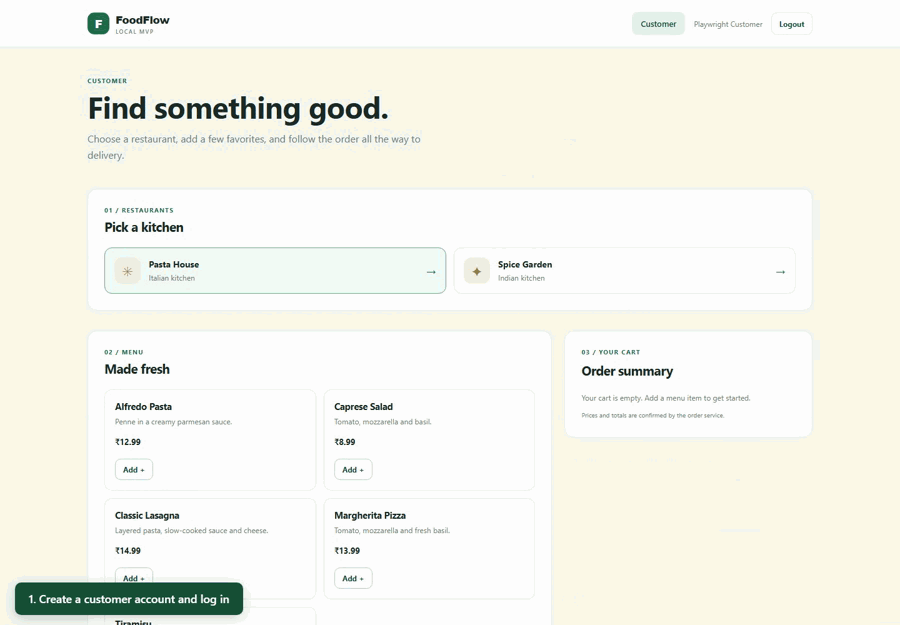

# FoodFlow

FoodFlow is a local food delivery MVP with React, four Node.js services, PostgreSQL, and a local Kafka broker. Users sign up and log in as customers, restaurant operators, or delivery partners. The project remains focused on service boundaries and event-driven architecture; it has no payments.

## GIF demo

For the Kafka architecture, event flow, recovery behavior and code references, see [How FoodFlow uses Kafka](KAFKA_PROJECT_GUIDE.md).

Customer ordering, restaurant preparation, and delivery in the running app (sped up).



## Local setup

Requires Node.js 18+, npm, and Docker Compose. From the project root:

```powershell
npm install --prefix frontend
npm install --prefix services/order-service
npm install --prefix services/restaurant-service
npm install --prefix services/delivery-service
npm install --prefix services/auth-service
Copy-Item .env.example .env
Copy-Item services/order-service/.env.example services/order-service/.env
Copy-Item services/restaurant-service/.env.example services/restaurant-service/.env
Copy-Item services/delivery-service/.env.example services/delivery-service/.env
Copy-Item services/auth-service/.env.example services/auth-service/.env
Copy-Item frontend/.env.example frontend/.env
```

Set `POSTGRES_PASSWORD` in the root `.env` and use it in every backend `DATABASE_URL`. Set the same random `JWT_SECRET` (at least 32 bytes) and `JWT_ISSUER` in all four backend files; set the same separate `INTERNAL_API_TOKEN` in them. Never put either secret in the frontend environment. Set `DEMO_PASSWORD` only in the Auth Service `.env` if you want seeded accounts. The examples are local development templates, not production secrets. If host port 5432 is busy, set `POSTGRES_HOST_PORT=5433` and change the port in all backend database URLs.

Set `KAFKA_BROKERS=localhost:9092` and `KAFKA_CLIENT_ID=foodflow` in the root `.env` for the Windows-hosted Kafka processes. Run `npm install` in the project root for KafkaJS and dotenv, then `npm run kafka:check` to verify the existing `order-events` topic. The Delivery Service consumer defaults to group `foodflow-delivery-service-v1` and saves a new group's starting offset at the topic's current end before processing; this position survives a crash before its first event commit. Set `KAFKA_CONSUMER_GROUP_ID` and `KAFKA_CONSUMER_START=earliest` only when deliberately replaying with an isolated group.

```powershell
docker compose --env-file .env -f infrastructure/docker-compose.yml up -d
npm run migrate
```

Migrations in `infrastructure/migrations/` are versioned, recorded in `public.schema_migrations`, and safe to rerun. The initialization SQL seeds restaurant and menu data only when PostgreSQL first starts. Keep the Docker volume; migration `002_auth.sql` preserves existing orders and demo identities.

Run each in a separate terminal:

```powershell
npm run dev:order
npm run dev:restaurant
npm run dev:delivery
npm run dev:auth
npm run dev:frontend
```

Run `npm run kafka:publisher` and `npm run kafka:consumer` in separate terminals to publish pending `ORDER_READY` outbox events and create available deliveries from them. Both are separate processes; the HTTP APIs continue to work when Kafka is unavailable. Run migrations before starting them.

Open <http://localhost:5173>. Frontend, Order, Restaurant, Delivery, and Auth use ports 5173, 3001, 3002, 3003, and 3004. To create repeatable development accounts, set `DEMO_PASSWORD` in `services/auth-service/.env` and run `npm run seed:demo`. The accounts are `customer@foodflow.local`, `restaurant@foodflow.local`, and `delivery@foodflow.local`; they share that development-only password. The restaurant account claims `restaurant-pasta-house`. You can also sign up in the UI. Selecting a restaurant or delivery role at signup is a **development-only shortcut**; production onboarding needs ownership verification.

## Authentication and ownership

The Auth Service owns `auth_data.users` and issues short-lived HS256 access tokens. It exposes `POST /api/auth/signup`, `POST /api/auth/login`, and `GET /api/auth/me`; `GET /api/auth/restaurants` lists available restaurants for signup. Login returns a safe user profile and access token. Send `Authorization: Bearer <token>` to public service endpoints. All services verify signature, algorithm, issuer, expiration, and role. Backend-to-backend calls continue to use `X-Internal-Token`, separate from user JWTs. Auth Service internal routes resolve restaurant ownership; Restaurant Service internal routes validate restaurant selection.

The frontend keeps the access token in application memory and shows only the page for the signed-in role. Logout clears that token. Refreshing the page clears the in-memory session and returns to login; no refresh tokens or persistent sessions are implemented. A previously issued token remains valid until its short expiry after client logout.

Customer users can browse restaurants and menus, place orders, and view only their own orders. Restaurant users can view and change orders for their claimed restaurant. Delivery partners can view available deliveries, claim one, and change only their own assignments. User IDs in request bodies or query strings do not grant access. Existing orders with legacy demo customer IDs remain in the database and are not silently assigned to new accounts.

## API and workflow

All services expose `GET /health`. Public endpoints require a bearer token except Auth signup/login and its restaurant selection endpoint.

| Service | Public endpoints | Role |
|---|---|---|
| Auth | `POST /api/auth/signup`, `POST /api/auth/login`, `GET /api/auth/me` | Open, open, authenticated |
| Order | `POST /api/orders`, `GET /api/orders`, `GET /api/orders/:id` | CUSTOMER |
| Restaurant | `GET /api/restaurants`, `GET /api/restaurants/:id/menu` | CUSTOMER |
| Restaurant | `GET /api/restaurant/orders`, `POST /api/restaurant/orders/:id/{accept,reject,preparing,ready}` | RESTAURANT owner |
| Delivery | `GET /api/deliveries/available`, `GET /api/deliveries`, `POST /api/deliveries/:id/{accept,picked-up,delivered}` | DELIVERY_PARTNER; assignment enforced |

An order request contains `restaurantId` and `items: [{ menuItemId, quantity }]`. Prices come from the Restaurant Service. Send a UUID `Idempotency-Key` header for safe order retries. The authenticated customer ID is used automatically. The lifecycle is `pending → accepted → preparing → ready_for_pickup → picked_up → delivered`; a pending order can instead become `rejected`. Invalid transitions return HTTP 409. Restaurant and delivery operations use stable operation IDs, and delivery reconciliation still handles ambiguous remote results. Internal status, operation lookup, ready-order pagination, and reconciliation endpoints require `X-Internal-Token`.

To try the workflow, log in as a customer and place an order; log out and log in as the restaurant operator to accept, prepare, and mark it ready; then log in as the delivery partner to claim, pick up, and deliver it. Log back in as the customer to see the delivered state. The pages refresh order and delivery lists every five seconds.

## Verification

### Record a video walkthrough

With FoodFlow, Kafka workers and demo accounts running, install Playwright Chromium (`npm --prefix frontend exec playwright install chromium`) and run:

```powershell
$env:ADMIN_PASSWORD = '<your admin password>'
npm run demo:record
Remove-Item Env:ADMIN_PASSWORD
```

This records two silent WebM videos in `demo-videos/`: the customer → restaurant → Kafka → delivery workflow (with chapter captions), and the super-admin dashboard, invoices and recorded errors. Without `ADMIN_PASSWORD`, only the order workflow is recorded. The walkthrough creates real demo orders. Videos and local environment files are excluded from Git; share the videos separately.

### Super admin and 1,000-order load test

Run migrations before using administration. Create the administrator locally with a password supplied through the environment (no default password is stored in source):

```powershell
npm run migrate
$env:ADMIN_EMAIL = 'admin@yopmail.com'
$env:ADMIN_PASSWORD = '<your admin password>'
npm run seed:admin
Remove-Item Env:ADMIN_PASSWORD
```

Log in at <http://localhost:5173>; `SUPER_ADMIN` accounts open `/admin`. Public signup cannot create this role. Admin APIs require an admin token and recheck the current database role. The dashboard lists every order using pagination, status/search/run filters, itemized printable order invoices, restaurant rejection reasons, delivery issue reports and recent failed authenticated actions. Delivery partners can report and resolve issues only for their own active assignments; completion resolves any open issue. This is an order invoice, not proof of payment; payments and taxes are not implemented. The local read-only admin reporting service joins service schemas; business operations still run through their owning services.

With the frontend, four APIs, Kafka, publisher and consumer running, and demo restaurant/delivery accounts seeded:

```powershell
npm run test:load -- --users 1000 --concurrency 20
```

The script creates a unique run, 1,000 customer fixtures with hashed passwords and one order per customer. It uses locally signed fixture tokens, preserving public authentication rate limits. This measures order processing; it does **not** measure public signup or login throughput. Restaurant and delivery actors are simulated with the existing demo accounts. The normal customer, restaurant and delivery APIs execute all transitions; database reads verify published outbox events, processed Kafka events, unique delivery records and item totals. No REST delivery backfill or HTTP retries hide Kafka or request errors. A customer's final API response must show `delivered`; this does not prove physical receipt.

Results are retained in `load-results/<run-id>/REPORT.md`, `report.json` and `cases.jsonl`, plus the admin dashboard. Every failed workflow includes its stage and observed error. A failed test is distinct from a rejected order or a transient action error. Interrupted tests exit with failure; force-killing the process can leave a run marked `running` for investigation. Accounts and orders are intentionally retained for review. Options include `--users 10 --concurrency 5` for a small check and `--kafka-timeout-ms 60000` for the bounded Kafka wait. The default is 1,000 users with 20 active workflows, not 1,000 simultaneous users. Local database access and installed service dependencies are required.

Admin browser verification:

```powershell
$env:ADMIN_PASSWORD = '<your admin password>'
npm --prefix frontend run test:admin
Remove-Item Env:ADMIN_PASSWORD
```

Before running the full integration suite, pause the long-running outbox publisher and delivery Kafka consumer, then restart both afterward. Kafka regression tests start their own publishers/consumers and need exclusive control of their test events.

With PostgreSQL and all four backends running:

```powershell
npm test
npm run test:integration
npm --prefix frontend run build
npm --prefix frontend exec playwright install chromium
npm --prefix frontend run test:e2e
```

The browser smoke test needs the frontend running too. Integration tests create and clean up their own users and orders; the browser test creates workflow orders and deletes its temporary signup user.

## Service boundaries and future events

`restaurant_data` owns restaurants and menus; `order_data` owns orders, status, items, and operation records; `delivery_data` owns assignments; `auth_data` owns identities and restaurant claims. Cross-service IDs are stored as values, without foreign keys across service schemas. The old demo identity rows remain for historical data.

Services still use bounded REST calls for commands and reads. When an order becomes ready, Order Service writes an `ORDER_READY` outbox row in the status transaction; the separate publisher sends it to Kafka with at-least-once delivery. Delivery Service consumes the event, verifies the order through the internal API, and creates an available delivery idempotently before committing the Kafka offset. REST polling, paginated backfill, and reconciliation remain for recovery. Invalid events and confirmed missing historical orders are recorded in `delivery_data.kafka_quarantine` for review. SNS, SQS, and notifications are future work.
